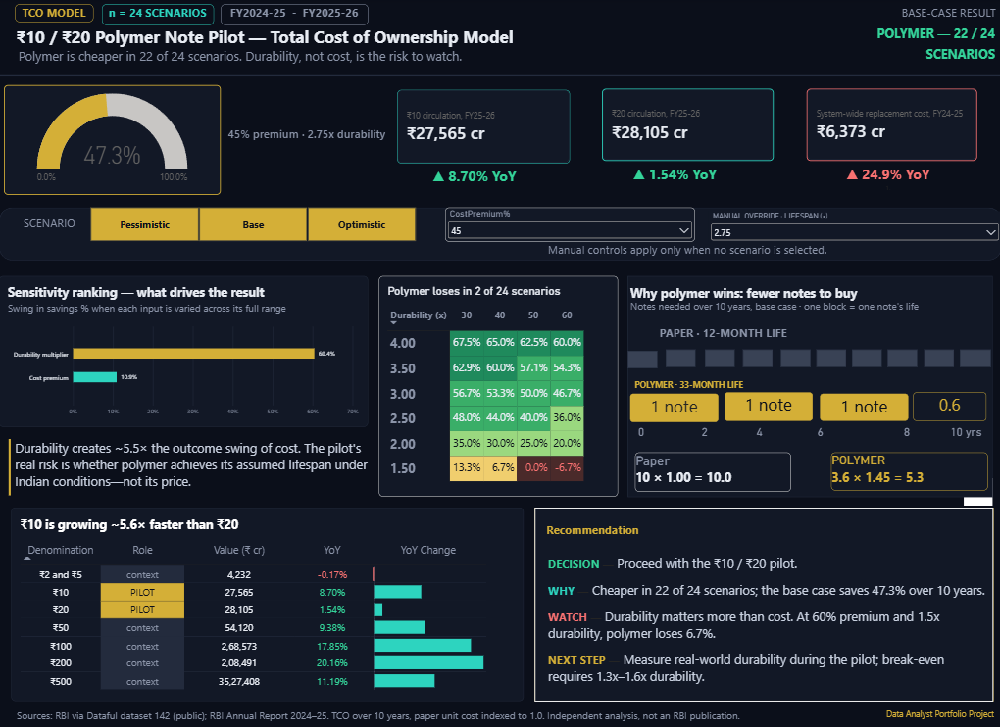

# Paper → Polymer: Cost Analysis of RBI's Rs 10 / Rs 20 Note Pilot

## The question
RBI is piloting polymer banknotes for Rs 10 and Rs 20. Polymer costs more to make but should last longer. Is the trade worth it, and how sure can we be?

## Finding ✏️
Over 10 years, polymer is cheaper in 22 of 24 tested scenarios (cost premium 30–60%, durability 1.5x–4x paper). At the base case (45% premium, 2.75x durability) total cost is about 47% lower. Durability moves savings across a 60.4-point range, against 10.9 points for cost premium, so field durability is the risk to watch. At 60% premium and 1.5x durability paper is cheaper (-6.7%).

## How to read the dashboard
- **Scenario tiles:** Pessimistic / Base / Optimistic
- **Gauge:** 10-year cost saving vs paper
- **Tornado:** which input matters more
- **Heatmap:** savings across all 24 combinations
- **Table:** Rs 10 / Rs 20 (pilot) next to other denominations (context)

## Method
10-year total cost = (120 ÷ note lifespan in months) × unit cost. Paper unit cost is indexed to 1.0; polymer = 1 + cost premium; polymer lifespan = durability multiplier × 12 months. Built in Power BI with What-if parameters and DAX.

## Data and limitations
- Circulation by denomination, FY2024-25 and FY2025-26: RBI via Dataful (dataset 142).
- Replacement cost: RBI Annual Report 2024-25 (system-wide, not by denomination).
- Cost is a normalised index, because absolute per-note cost is not public. The 30–60% premium range and the 1.5x–4x durability range come from public reporting and manufacturer claims; the base case uses the midpoints.
- Only two years of denomination-wise data. Rs 2000 is excluded because it was withdrawn in May 2023, before the study period.
- Independent analysis, not an RBI publication.

## Files
- `powerbi/Polymer_Note_TCO_Dashboard.pbix` (open in Power BI Desktop)
- `Recommendation_Memo.pdf` (one-page recommendation)

## Tools
Power BI, DAX, Excel

_Built with AI assistance (Claude) for planning and drafting; the analysis choices, data checks and numbers were reviewed by me._
